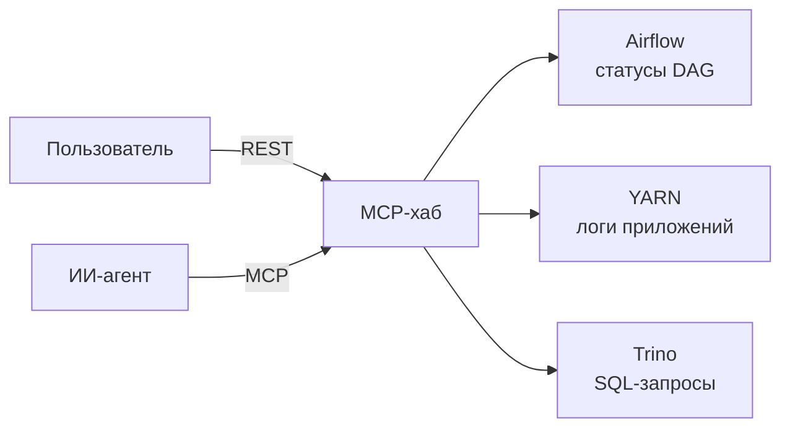

<h1 align="center">Александр Вагнер</h1>

  <b>Разработчик дата-платформы</b> 
  MCP-хаб · REST + MCP · ИИ-агенты в разработке

  
  
  

> Раньше данные были таблицами. Теперь данные — это интерфейс.

## Что я строю

Полтора года работаю над дата-платформой банка. До этого два года — инженером данных: ETL, хранилища, отчёты.

**Сейчас** — строю **MCP-хаб**, единую точку входа к сервисам платформы: посмотреть статусы DAG в Airflow, прочитать логи приложения в YARN, выполнить SQL-запрос через Trino. Люди и ИИ-агенты обращаются к платформе одинаково: один контракт, один слой авторизации, одна документация.

## Как работаю

Индустрия укрупняет роли: аналитик, разработчик, тестировщик и дежурный схлопываются в одного **продуктового инженера**, а команды сжимаются до tiny teams. Укрупнение стало возможным благодаря ИИ: границы между соседними областями перестали быть барьером — задачу из чужой зоны можно подхватить, а не ждать освободившегося специалиста. Я работаю в этой парадигме последние годы.

В моей команде три разработчика, и на троих — весь цикл: разобраться в задаче, спроектировать контракт, написать код, покрыть тестами, выкатить и ответить, если ночью что-то упало.

## Стек

    
    
    
    
    
    
    
    
    
    

профиль, который давно притворяется сервисом

